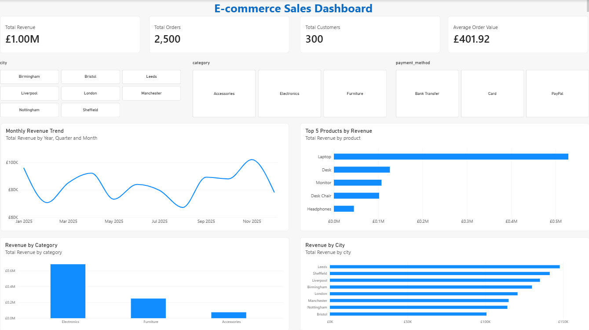

# E commerce Sales and Customer Analysis

MySQL and Power BI portfolio analysis of 2,500 orders dated in 2025. The project explores revenue, product performance, geographic sales, customer segmentation and purchase retention.

## Dataset provenance and availability

The dataset was downloaded, but its original source and licence are unknown. Whether it describes real or synthetic transactions has not been verified. It is used here for portfolio analysis; findings should not be presented as results delivered to an employer or client.

The source CSV and Power BI file are not distributed in this public repository. The CSV includes customer names, and the Power BI file contains an embedded data model. The screenshot presents aggregate results without customer names. The SQL contains queries, not the underlying customer records.

## Results checked against the supplied CSV

| Metric | Result |
|---|---:|
| Distinct orders | 2,500 |
| Distinct customers | 300 |
| Revenue | £1,004,792.45 |
| Average order value | £401.92 |

Revenue is calculated as quantity multiplied by unit price. Average order value is total revenue divided by distinct orders. Order identifiers are unique in the supplied CSV. The data includes no cost or profit fields, so this project does not establish profitability. Currency is presented as GBP in the original dashboard; independent source documentation is unavailable.

The CSV has 2,500 rows and 10 columns. Checks found no missing fields, duplicate rows or duplicate order identifiers. These checks do not establish the dataset's authenticity or completeness.

## Findings

- Laptop contributes the highest product revenue: **£528,789.12**.
- Electronics contributes the highest category revenue: **£681,412.60**.
- Leeds has the highest city revenue: **£147,831.48**.
- November has the highest monthly revenue: **£102,070.77**.
- August has the lowest monthly revenue: **£67,107.99**.

These are descriptive comparisons. They do not establish why differences occur or demonstrate recurring seasonality. A real business would investigate promotions, product mix, stock availability and acquisition costs before taking action.

## SQL techniques present in the supplied script

- Null, duplicate, range and category checks
- Aggregation, GROUP BY and HAVING
- CASE expressions and customer spending segments
- Common table expressions
- DENSE_RANK, NTILE and LAG window functions
- Running revenue totals and month-over-month growth
- Repeat-customer counts and rates
- Cohort assignment, monthly activity and retention calculations

The script was reviewed, and headline figures were independently recalculated from the CSV using Python. It has not been executed in a MySQL server during this review. Indexing and query optimisation are not claimed because the supplied script does not demonstrate them.

## Analysis definitions and limitations

Customer cohorts use the first purchase observed in the 2025 extract; this may not be a customer's first-ever purchase. Retention measures whether a customer buys in a later month, rather than requiring uninterrupted monthly purchasing. Later cohorts have shorter follow-up periods. The SQL returns observed cohort-month activity; absent combinations are not automatically filled with zero.

The section called New vs Repeat Customers labels customers by their total order count over the extract. It is not a monthly new-customer metric. Fixed spending thresholds are demonstration choices rather than externally validated business rules. NTILE divides customers into groups of similar size and can split equal-spending customers across quartiles.

Month-over-month calculations compare months present in the extract. All 12 months of 2025 appear here; a generalised implementation should account for missing calendar months.

## Power BI report

The supplied report contains revenue, order, customer and average-order-value cards; monthly revenue, top products, category and city charts; and City, Category and Payment Method slicers. The order card uses a formatted display measure so it shows **2,500**, while the numeric measure remains available for calculations.

The public preview is static. Interactive filtering, source refresh and the DAX measure definitions have not been independently tested in Power BI Desktop during this review.

## Files

| File | Purpose |
|---|---|
| `README.md` | Methods, checked results and limitations |
| `ecommerce_sales_analysis.sql` | Supplied MySQL analysis script |
| `dashboard.png` | Updated aggregate dashboard screenshot |

## Reproduce with your own permitted data

The source dataset is not included, so this repository does not reproduce the original results on its own. To try the SQL with data you have permission to use:

1. Use MySQL 8.0 or later because the script uses CTEs and window functions.
2. Import a table called `ecommerce_sales_raw` with these fields: `order_id`, `order_date`, `customer_id`, `customer_name`, `city`, `product`, `category`, `quantity`, `unit_price`, `payment_method`.
3. Store `order_date` as a date, identifiers and quantity as suitable integer types, unit price as an appropriate fixed-point decimal, and descriptive fields as text. The supplied script assumes this table already exists; it contains no table-creation or CSV-import commands.
4. Open the SQL script in MySQL Workbench and run each statement separately, starting with the data checks. Review any quality issues before interpreting totals.

Results from another dataset will differ. Keep private customer records out of screenshots and public repositories.
